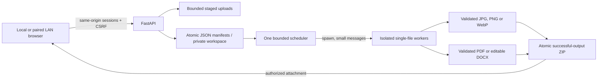

# CapreConvert architecture

One workspace lock prevents competing schedulers. The server owns jobs across browser refresh.
Uploads carry owner IDs and job references. Terminal jobs retain committed results 24 hours.
Restart marks active jobs interrupted and removes partials; retry is explicit.
Disk reservations include staging, RGB-size output allowance and ZIP duplication. Worker memory
is admitted with a bounded 256 MiB inspection stage, then a conservative pixel budget
or configured document process-tree budget. External LibreOffice descendants are included.
The default additional safety reserve is 768 MiB of currently available memory. Peer workers
reserve only their future growth; current RSS is not counted twice. Deferred workers park
before unpacking and remain cancellable/time-limited. One supervisor enforces global
concurrency, RSS caps and system pressure. See MEMORY_OPTIMIZATION.md for calibration.
RSS sampling is resource protection, not a hard operating-system sandbox.

The conversion registry freezes each job's input/output contract while missing legacy
conversion settings retain CR3/JPEG behavior. Document parsers/rendering run only inside
supervised workers. LibreOffice uses a fresh high-security private profile; file-backed
pypdf/python-docx processing is bounded by stream, page, text, expansion and output limits.
Generated document scratch is removed on completion/failure/cancel and restart recovery.
Public branding changes to CapreConvert while legacy workspace/cookie/environment/package
identities remain. See V0_3_PLAN.md, V0_3_MIGRATION.md and V0_3_VALIDATION.md.

v0.4: explicit engine/preview/archive capabilities replace is_raw dispatch. Ordinary rasters
use a lazy Pillow worker, inspect bounded headers, request a dimension-derived total RSS
budget (max256MiB,128MiB+40P) before decoding, normalize/resize/encode, fully decode for
validation, atomically publish, then derive alpha-preserving reduced PNGs from those exact
validated output pixels. Native WebP reads the full encoded stream on open, so a bounded
RIFF/VP8/VP8L/VP8X inspection precedes Pillow admission. Animated inputs are rejected.

A single execution lock serializes demand previews with complete conversion jobs; at most
four preview requests wait by default. Waiting has a deadline, then actionable retry. PDFium,
OOXML and legacy-image preview processing run in spawned workers with memory/time/disk/page/
text limits. PDF pages are lazy, forms disabled, no JavaScript engine enabled. Cached
preview hashes/renderer/options are verified; duplicate requests reuse one derivative.
Managed cache files share the parent job directory, quota and deletion/download leases.
Restart removes parts and uncommitted scratch, retaining only verified output/cache files.
Neither cached serving nor direct download decodes content in the HTTP process.

v1.0 selection/navigation: capabilities add an explicit formats catalog (stable IDs,
labels and image/document categories) and source_format/target_format on existing conversion
entries. A native picker filters advertised pairs only. Pending dropdown state lives in
picker.js; workspace uploads/settings/jobs remain in app.js and change only on explicit
Open converter or established routes. Ambiguous engine pairs disable the picker action.
All capabilities remain authenticated. No parsing/renderer/worker/admission changes.
