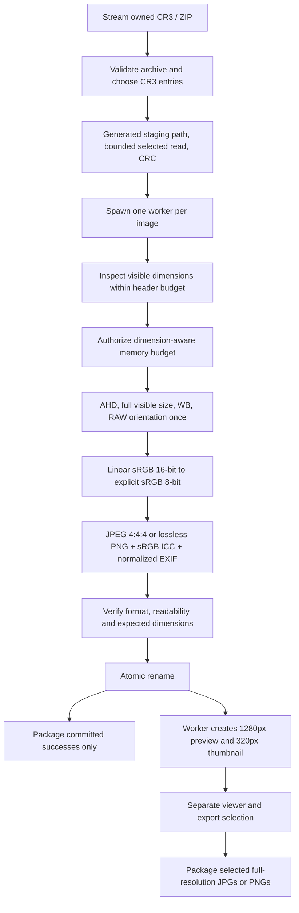

# v0.4 raster and preview extension

The existing RAW/document pipelines below retain their defaults. Ordinary images route to
localraw/raster.py using explicit engine capabilities; committed PDF/DOCX/image demand
previews use localraw/previews.py. Exact codec/resize/colour/alpha/privacy/bounds are in
OPTIMIZATION_PREVIEWS.md; executed gates and measurements are in V0_4_VALIDATION.md.

# CapreConvert conversion pipelines

v0.3.0 freezes a conversion key per job. CR3-to-PNG uses the same full-size normalized
8-bit sRGB pixels as the existing RAW pipeline with lossless PNG encoding instead of
JPEG. Both image types receive JPEG preview/thumbnail derivatives; exports always use
the full converted file. DOCX-to-PDF uses external local LibreOffice with a private profile;
text-PDF-to-DOCX creates editable paragraphs/page breaks without OCR or layout reconstruction.
All engines run inside supervised worker processes and commit only validated files.
Document ZIP/XML/PDF bounds, setup requirements and executed native evidence are recorded
in V0_3_VALIDATION.md. The image pipeline details below preserve the original rendering.

Exact rawpy parameters: AHD; half_size=False; use_camera_wb=True (unless auto selected
or invalid WB); output_color=sRGB; gamma=(1,1); output_bps=16; no_auto_bright=True;
bright=1; noise reduction off; no extra sharpening; automatic RAW orientation only.
Apply standard piecewise sRGB transfer at 0.0031308, then quantize to RGB8 and embed
Pillow LittleCMS sRGB profile. Test transfer numerically; real color validation needs fixtures.
The ICC registry defines the [sRGB transfer function](https://registry.color.org/rgb-registry/srgb).
Tests parse the actual embedded LittleCMS profile's three parametric TRCs and verify they
invert our transfer within ICC fixed-point quantization error (3e-5 in linear light).
JPEG quality 70–100 (95 default), subsampling=0. Dimensions exclude sensor margins.

The sRGB transfer is precomputed for all 65,536 uint16 values with the same float32
arithmetic as the prior implementation. Bounded 128-row by 2048-column tiles fill the
Pillow RGB image, avoiding a second full-size RGB8 NumPy array. Native RAW resources
close after postprocessing; the linear array is released before JPEG encoding, and
Pillow buffers are explicitly closed before the next full-image validation step.
JPEG readability validation still decodes the full result. Preview creation uses the
JPEG decoder's native scaled mode before thumbnailing, avoiding another full-size decode.
The exported JPEG retains its original dimensions, rendering parameters and quality.

One supervisor serializes jobs; image concurrency defaults to one. A second image is
started only when available headroom supports it, and its dimension handshake can wait
before native unpacking while a peer finishes. Waiting remains cancellable and counts
toward the configured file timeout. A new subprocess per image releases native memory
after each file. Source spawn children avoid importing the web-server graph; frozen
children already dispatch through `freeze_support()` before application startup.

Memory admission uses a 256 MiB header-inspection budget, then a conservative total-worker
RSS budget of `max(256 MiB, 128 MiB + 48 * visible_pixels)`. The default safety reserve
is 768 MiB, configurable with a 256 MiB lower bound. Admission credits the worker's
existing resident pages and reserves only peers' unallocated budget growth. Memory is
normally sampled every 0.5 seconds; worker budget excess or sustained system pressure
stops affected work with a useful retry message. These policy values are not universal
minimum RAM claims. Authenticated `/api/v1/resources` exposes sampled process-tree RSS;
per-file results record observed peaks, including Windows lifetime working-set counters.
Process RSS can double-count shared pages and polling cannot guarantee a hard allocation cap.

Uploads, selected ZIP-member extraction and result ZIP creation remain disk-backed and
chunked. Archive entry/directory/size/ratio guards, path safety and cleanup are retained.
Only the current selected RAW member is staged for a worker; no full batch pixel buffers
are loaded into the HTTP process.

Workers derive previews from the committed, validated normalized JPEG, with no further
orientation operation. Preview/thumbnail longest edges are 1280/320, JPEG quality 82, with
sRGB ICC and Orientation=1 only; capture/GPS EXIF is omitted. Both are bounded and atomically
published as a pair. Preview failure warns while retaining the full-resolution successful JPG.
JPEG exports and existing whole-batch ZIPs never include reduced preview derivatives.
Optional bounded/time-limited ExifTool whitelists fields. GPS requires opt-in. Missing tool
or unsupported metadata yields warnings, never prevents otherwise valid conversion.

Compatibility evidence now includes three private, provenance-recorded real CR3 samples
with 5536 x 3692 and portrait 3692 x 5536 output, used only for local benchmarks.
The private manifest is `test-results/memory-inputs/manifest.json`; files are not
redistributed. Direct native before/after JPEGs have identical decoded full-resolution
pixels, dimensions, orientation, quantization and sampling. The real overall peak was
effectively unchanged at approximately 357 MiB; a separate synthetic encode-stage probe
showed lower memory use. See MEMORY_OPTIMIZATION.md and VALIDATION.md for exact evidence.
The v0.2.0 Windows package also completed single, sequential batch, ZIP and repeated
private-input conversions with the default configuration: ten verified full-resolution
4:4:4 JPEGs, exactly one converter at a time, and sampled process-tree peaks of
417.40-436.95 MiB for single/batch/ZIP work and 413.16 MiB for repeated sessions.
Idle tree RSS was 78.60 MiB. The tree includes the HTTP process and a Windows
helper/console process; it is distinct from the direct native probe above.
Successful render admissions occurred with 2.219-2.302 GiB of available system RAM.
Cancellation during native work, corrupt-input rejection, configured low-memory policy
rejection and temporary-file cleanup were exercised in the packaged app. These results
support this small private sample set and do not establish a universal RAM minimum.
The broader camera/model/RAW/C-RAW matrix, reference-scene color validation and actual
ExifTool metadata validation remain open. The separate pytest camera gate remains skipped
until its required `tests/fixtures/manifest.json` contract is populated.
